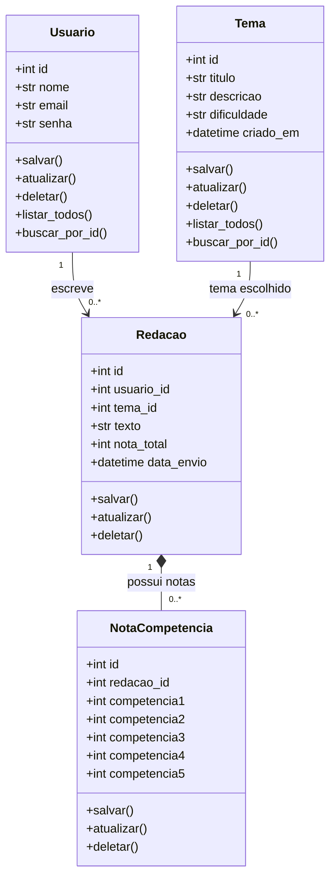

# Diagrama de classes do domínio

`Usuario`, `Tema`, `Redacao` e `NotaCompetencia` herdam de `db.Model`. A relação entre `Redacao` e `NotaCompetencia` usa composição lógica: as notas dependem da redação e são removidas junto com ela.
